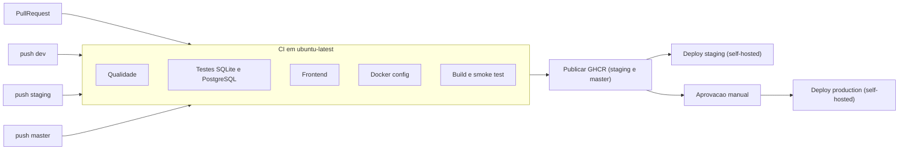

# WarehouseFlow — CI/CD (GitHub Actions)

Pipeline de integração e entrega contínua: CI nos runners do GitHub, imagens no GitHub Container Registry (GHCR) e deploy por um runner self-hosted na VM Debian. Staging é automático; produção exige aprovação.

## Visão geral



| Evento | O que roda |
|--------|-----------|
| Pull request para `dev`, `staging` ou `master` | Só CI |
| Push em `dev` | Só CI |
| Push em `staging` (merge do PR `dev` → `staging`) | CI → publish → deploy staging |
| Push em `master` (merge do PR `staging` → `master`) | CI → publish → **aprovação** → deploy production |

Publicação e deploy dependem (`needs`) de todos os jobs de CI na mesma execução: sem CI verde, nada é publicado nem implantado.

Arquivos:

| Arquivo | Função |
|---------|--------|
| [`.github/workflows/ci-cd.yml`](../../.github/workflows/ci-cd.yml) | CI, publish e deploy |
| [`.github/workflows/rollback.yml`](../../.github/workflows/rollback.yml) | Rollback manual |
| [`deploy/scripts/deploy.sh`](../../deploy/scripts/deploy.sh) | Deploy no servidor (com rollback automático) |
| [`deploy/scripts/rollback.sh`](../../deploy/scripts/rollback.sh) | Rollback no servidor |
| [`deploy/scripts/healthcheck.sh`](../../deploy/scripts/healthcheck.sh) | Validação `/health` + `/ready` |
| [`deploy/scripts/common.sh`](../../deploy/scripts/common.sh) | Funções compartilhadas |
| [`scripts/ci/check_frontend.py`](../../scripts/ci/check_frontend.py) | Validação do frontend |
| [`ruff.toml`](../../ruff.toml) | Regras do ruff (só erros reais) |

## Jobs de CI

| Job | Verifica |
|-----|----------|
| Qualidade | `ruff check` (sintaxe, nomes indefinidos), `compileall` do backend, `actionlint` dos workflows, `shellcheck` dos scripts, `hadolint` dos Dockerfiles (falha só em erro) |
| Testes (sqlite) | Suíte completa `pytest` em SQLite em memória (como no desenvolvimento) |
| Testes (postgres) | Mesma suíte com `TEST_DATABASE_URL` num PostgreSQL 16 descartável: ativa os testes de schema, seed, constraints e CRUD no PostgreSQL |
| Frontend | Parse de todos os templates Jinja2, existência de templates referenciados e de arquivos `/static/...`, `node --check` em cada JS |
| Configuração Docker | `docker compose config` dos três Compose (dev, prod com os exemplos de staging e produção, monitoramento) e `nginx -t` das duas confs |
| Build e smoke test | Build das imagens API e Nginx, sobe `docker-compose.prod.yml` num projeto descartável e valida `/health` (versão = tag) e `/ready` via Nginx |

Resultados: resumo em cada execução (aba **Summary**) e artefatos `pytest-sqlite`, `pytest-postgres` (JUnit + log) e `smoke-logs` (em falha).

## Imagens

- `ghcr.io/<owner>/warehouseflow-api` e `ghcr.io/<owner>/warehouseflow-nginx`
- Tags: `sha-<7 primeiros do commit>` (imutável, usada no deploy) e o nome do branch (`staging` ou `master`)
- A imagem publicada é a mesma que passou no smoke test (exportada do job de build, sem rebuild)
- Autenticação com o `GITHUB_TOKEN` automático: nenhuma credencial de registry em Secrets

`docker-compose.prod.yml` usa `${API_IMAGE:-warehouseflow-api}:${IMAGE_TAG:-${APP_VERSION:-latest}}`. Sem essas variáveis, o deploy manual com `up -d --build` continua igual.

## O que o deploy faz no servidor

`deploy/scripts/deploy.sh <ambiente> <tag>`, executado pelo runner no diretório `DEPLOY_PATH`:

1. **Pré-checagem**: diretório, clone Git, `docker`, `curl` e Secrets obrigatórios. Sem o diretório, falha com "Ambiente production ainda não criado".
2. **Git**: `git fetch` + `git merge --ff-only <sha>` no branch do ambiente (sem `reset`/`force`; falha se houver divergência).
3. **Backup do banco** (`pg_dump -Fc` em `backups/<ambiente>-predeploy-*.dump`): obrigatório em produção; em staging só com a Variable `BACKUP_DB=true`.
4. **Ponto de rollback**: marca as imagens em execução como `warehouseflow-api:rollback-<ambiente>` e `warehouseflow-nginx:rollback-<ambiente>`.
5. **`.env.<ambiente>`**: gerado a partir dos Secrets/Variables (permissão 600, valores entre aspas simples, nunca exibido). O anterior vai para `.deploy/backups/` (mantém os 20 últimos).
6. **Atualização**: `docker compose pull api frontend` e `up -d --no-build --no-deps --wait api frontend`. O `db` só é criado se não estiver rodando; nunca há `down` nem remoção de volume.
7. **Health check**: `http://127.0.0.1:<HTTP_PORT>/health` com `version` igual à tag e `/ready` 200.
8. **Falha em 6 ou 7**: restaura o `.env` anterior, volta para as imagens `:rollback-<ambiente>`, valida a saúde e marca o job como falho.
9. **Registro**: linha em `.deploy/history.log` (data, ambiente, tag, commit, resultado) e resumo no GitHub.

Migrations SQL **não** são executadas pelo pipeline (como em [deploy.md](deploy.md#migrations-sql-bancos-já-existentes)).

## Configuração (uma vez)

### 1. Runner self-hosted na VM

No GitHub: **Settings → Actions → Runners → New self-hosted runner → Linux**. A página mostra os comandos de download e um token temporário. Na VM, como `vboxuser`:

```bash
mkdir -p ~/actions-runner && cd ~/actions-runner
# Baixe e extraia o pacote com os comandos exibidos na página do GitHub (curl + tar).
./config.sh --url https://github.com/thiagodemorais87/WarehouseFlow \
  --token <TOKEN_DA_PAGINA> --name warehouseflow-debian --unattended
sudo ./svc.sh install vboxuser
sudo ./svc.sh start
sudo ./svc.sh status
```

O runner deve ficar só com as labels padrão (`self-hosted`, `Linux`, `X64`). Os workflows usam `runs-on: self-hosted`, então não é preciso criar label customizada. Se o runner já tiver sido registrado com `--labels warehouseflow`, basta removê-la em Settings → Actions → Runners (não é necessário reinstalar).

Requisitos do usuário do runner:

- Estar no grupo `docker` (`groups vboxuser`; se faltar: `sudo usermod -aG docker vboxuser` e reinicie o serviço do runner).
- Ser dono do clone em `/opt/warehouseflow/staging` (evita o erro "dubious ownership" do Git).
- `git` e `curl` instalados.

O token do `config.sh` é de uso único e expira em 1 hora; não o salve em arquivos nem envie em mensagens.

### 2. Environments e Secrets

**Settings → Environments → New environment**.

Environment **`staging`**:

- Deployment branches: **Selected branches** → `staging`
- Secrets (**Add environment secret**):

| Secret | Valor |
|--------|-------|
| `POSTGRES_USER` | Usuário do PostgreSQL de staging |
| `POSTGRES_PASSWORD` | Senha **atual** do PostgreSQL de staging |
| `POSTGRES_DB` | Nome do banco de staging |
| `SECRET_KEY` | Chave JWT de staging: aleatória, **mínimo 32 caracteres** (a API recusa iniciar em staging/produção com chave fraca). Gere com `openssl rand -hex 32` |

- Variables (**Add environment variable**):

| Variable | Exemplo |
|----------|---------|
| `DEPLOY_PATH` | `/opt/warehouseflow/staging` |
| `HTTP_PORT` | `80` |
| `APP_ENV` | `staging` |
| `COOKIE_SECURE` | `false` (até ter HTTPS) |
| `ENABLE_DOCS` | `false` |
| `BACKUP_DB` | `true` ou `false` (opcional) |

Environment **`production`**: os mesmos Secrets e Variables com os valores de produção, mais:

- **Required reviewers**: você (e quem mais aprovar deploys)
- Deployment branches: **Selected branches** → `master`
- `DEPLOY_PATH=/opt/warehouseflow/production`; se ficar na mesma VM do staging, use outra `HTTP_PORT` (ex.: `8088`)

> A senha do banco no Secret precisa ser **idêntica** à atual. O volume do PostgreSQL já foi inicializado: trocar `POSTGRES_PASSWORD` no Secret não muda a senha do banco e quebra o `/ready` (o deploy falha e faz rollback automático).

Para copiar os valores atuais do staging para os Secrets, consulte o arquivo **na VM** e digite os valores direto no GitHub (nunca em chat, issue ou commit):

```bash
cd /opt/warehouseflow/staging
grep -E '^(POSTGRES_USER|POSTGRES_DB|HTTP_PORT|APP_ENV|COOKIE_SECURE|ENABLE_DOCS)=' .env.staging
nano .env.staging   # copie POSTGRES_PASSWORD e SECRET_KEY daqui; saia sem salvar
```

### 3. Proteção de branches

**Settings → Branches → Add branch ruleset** (ou *branch protection rule*) para `staging` e `master`:

- Require a pull request before merging
- Require status checks to pass: `Qualidade`, `Testes (sqlite)`, `Testes (postgres)`, `Frontend`, `Configuração Docker`, `Build e smoke test`
- Block force pushes

Os nomes dos checks aparecem para seleção depois da primeira execução do workflow.

### 4. Branch padrão

O botão **Run workflow** do `rollback.yml` só aparece se o workflow estiver no branch padrão (hoje `main`). Escolha uma opção:

- **Settings → General → Default branch** → `master` (recomendado, fim do fluxo `dev → staging → master`), ou
- levar `.github/workflows/` também para `main`.

### 5. Permissões do Actions

- **Settings → Actions → General → Fork pull request workflows**: exigir aprovação para colaboradores externos. Os jobs self-hosted nunca rodam em `pull_request`, mas isso reduz o risco.
- **Workflow permissions**: pode ficar *Read repository contents*; o workflow pede `packages: write` só no job de publish.

### 6. Pacotes no GHCR

Após o primeiro publish, os pacotes `warehouseflow-api` e `warehouseflow-nginx` aparecem em **Packages** do perfil. Confira em **Package settings → Manage Actions access** que o repositório `WarehouseFlow` tem acesso (normalmente automático, pela label `org.opencontainers.image.source`).

## Primeiro deploy em staging

1. Runner online (**Settings → Actions → Runners** → `warehouseflow-debian` *Idle*).
2. Environment `staging` com Secrets e Variables preenchidos.
3. Na VM, o clone em `/opt/warehouseflow/staging` está no branch `staging` e sem alterações em arquivos versionados (`git status`).
4. Abra e faça merge do PR `dev` → `staging`.
5. Acompanhe em **Actions → CI/CD**. Ao final, na VM:

```bash
cd /opt/warehouseflow/staging
cat .deploy/history.log
curl -s http://127.0.0.1/health
docker compose -p warehouseflow-staging --env-file .env.staging -f docker-compose.prod.yml ps
```

O primeiro deploy substitui o `.env.staging` pelo gerado; o original fica em `.deploy/backups/`.

## Produção

Enquanto `/opt/warehouseflow/production` não existir, todo push em `master` cria um deploy aguardando aprovação que falha na pré-checagem com a mensagem "Ambiente production ainda não criado". Rejeite a aprovação ou deixe falhar.

Para criar o ambiente (na mesma VM ou em outro servidor com runner próprio):

```bash
sudo mkdir -p /opt/warehouseflow/production
sudo chown vboxuser:vboxuser /opt/warehouseflow/production
git clone -b master https://github.com/thiagodemorais87/WarehouseFlow /opt/warehouseflow/production
```

Depois preencha o environment `production` e faça um novo merge em `master` (ou reexecute o job).

## Rollback

**Automático**: se `pull`, `up` ou o health check falharem, o `deploy.sh` volta sozinho para a versão anterior.

**Manual (GitHub)**: **Actions → Rollback → Run workflow**:

- *Use workflow from*: `staging` para staging, `master` para production (regra de branches do environment)
- `environment`: `staging` ou `production` (production pede aprovação)
- `image_tag` vazio: volta para a versão anterior ao último deploy (imagens locais `:rollback-<ambiente>`)
- `image_tag` preenchido (ex.: `sha-abc1234`): implanta essa tag do GHCR. Veja as tags em `.deploy/history.log` ou em **Packages**

**Manual (na VM, sem GitHub)**: ver [rollback.md](rollback.md#rollback-pelo-cicd-imagens).

O rollback troca só as imagens; o clone Git do servidor continua no commit mais novo. Se a mudança problemática estiver em `docker-compose.prod.yml` ou nas confs, reverta o commit e faça um novo deploy.

## Logs e resultados

| Onde | O quê |
|------|-------|
| Actions → execução → **Summary** | Testes (aprovados/falhas/ignorados), imagens publicadas, resultado do deploy |
| Actions → execução → **Artifacts** | `pytest-*` (JUnit + log), `smoke-logs`, `deploy-<ambiente>-log`, `rollback-<ambiente>-log` |
| VM: `.deploy/history.log` | Histórico de deploys e rollbacks |
| VM: `backups/` | Dumps antes do deploy (produção sempre). Não há limpeza automática: mova para fora da VM periodicamente |

## Segurança

- Nenhuma senha no repositório: segredos só em GitHub Environments; o `.env` gerado tem permissão 600 e não é exibido nos logs (o GitHub mascara os Secrets).
- Jobs self-hosted só rodam em `push` para `staging`/`master` e em `workflow_dispatch`, nunca em `pull_request`.
- O usuário do runner no grupo `docker` equivale a root na VM: não instale outros serviços sob esse usuário se a VM for compartilhada.
- Valores com aspas simples ou quebra de linha não são aceitos nos Secrets (o deploy recusa com mensagem clara).

## Alternativa futura: deploy por SSH (EC2)

Para um servidor com IP público, dá para trocar o runner self-hosted por SSH a partir dos runners do GitHub. Secrets necessários (só então):

| Secret | Conteúdo |
|--------|----------|
| `DEPLOY_SSH_KEY` | Chave privada de deploy (gerada só para isso, sem senha) |
| `DEPLOY_HOST` | IP ou DNS do servidor |
| `DEPLOY_USER` | Usuário de deploy no servidor |

Restrinja a porta 22 no Security Group e nunca envie a chave privada em mensagens ou commits.

## Validação local

Os mesmos checks do CI, em containers descartáveis (PowerShell, na raiz do repositório):

```powershell
$root = $PWD.Path
docker run --rm -v "${root}:/repo" -w /repo rhysd/actionlint:1.7.12 -no-color
docker run --rm -v "${root}:/mnt" -w /mnt koalaman/shellcheck:stable -x deploy/scripts/common.sh deploy/scripts/deploy.sh deploy/scripts/rollback.sh deploy/scripts/healthcheck.sh
docker run --rm -e PYTHONPYCACHEPREFIX=/tmp/pycache -v "${root}:/src" -w /src python:3.12-slim sh -c "pip install -q -r requirements.txt ruff==0.8.4 && ruff check --no-cache . && python scripts/ci/check_frontend.py && python -m pytest -q -p no:cacheprovider"
docker compose -p warehouseflow-staging --env-file .env.staging.example -f docker-compose.prod.yml config -q
```

## Problemas comuns

| Sintoma | Causa provável |
|---------|----------------|
| Job de deploy fica em *Queued* | Runner offline ou sem o label `warehouseflow` |
| `variáveis obrigatórias ausentes` | Secrets/Variables não criados no environment |
| `Ambiente ... ainda não criado` | `DEPLOY_PATH` não existe no servidor |
| `não foi possível avançar ... fast-forward` | Commits ou alterações locais no clone do servidor |
| `denied` no `docker pull` | Repositório sem acesso ao pacote no GHCR (item 6 da configuração) |
| `/ready` falha e há rollback | `POSTGRES_PASSWORD` do Secret diferente da senha real do banco |
| API reinicia com `SECRET_KEY fraca ou placeholder` | `SECRET_KEY` com menos de 32 caracteres ou valor de exemplo |
| `permission denied ... docker.sock` | Usuário do runner fora do grupo `docker` |
