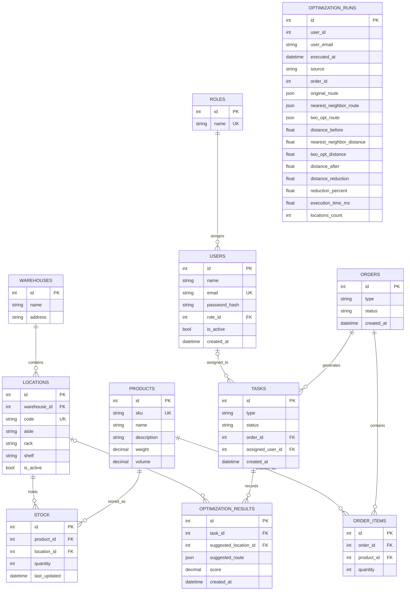

# MER final — WarehouseFlow

Este diagrama foi reconstituído a partir de `backend/database/schema.sql`,
`backend/app/models/` e `backend/app/models/optimization_run.py`. É um modelo
do código; a verificação de uma instância PostgreSQL real ficou pendente por
indisponibilidade do daemon Docker.

`stock` tem restrição única em `(product_id, location_id)` e quantidade não
negativa; itens de pedido exigem quantidade positiva e preservam a referência
ao produto (`ON DELETE RESTRICT`). O pedido é pai de itens e tarefas; a remoção
do pedido é em cascata. `optimization_runs` é tabela adicional do modelo ORM:
`user_id` e `order_id` são valores de histórico, sem chaves estrangeiras
declaradas nessa tabela.

Inventário observado na base SQLite descartável, criada pela aplicação para
smoke tests: 11 tabelas e as FKs listadas em
[`evidencias/S10-database-schema.txt`](./evidencias/S10-database-schema.txt).
Esse artefato não é evidência de conexão PostgreSQL.
