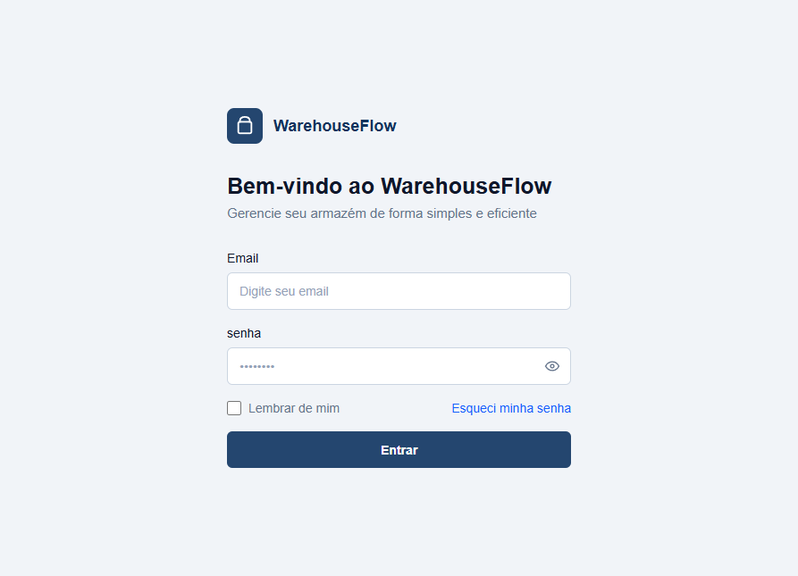
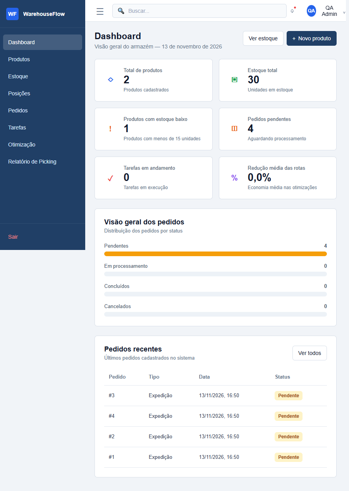
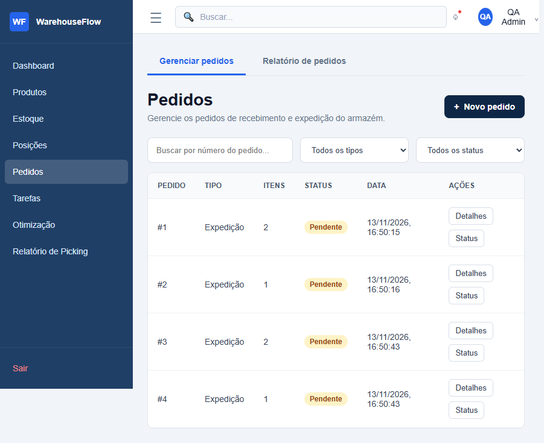
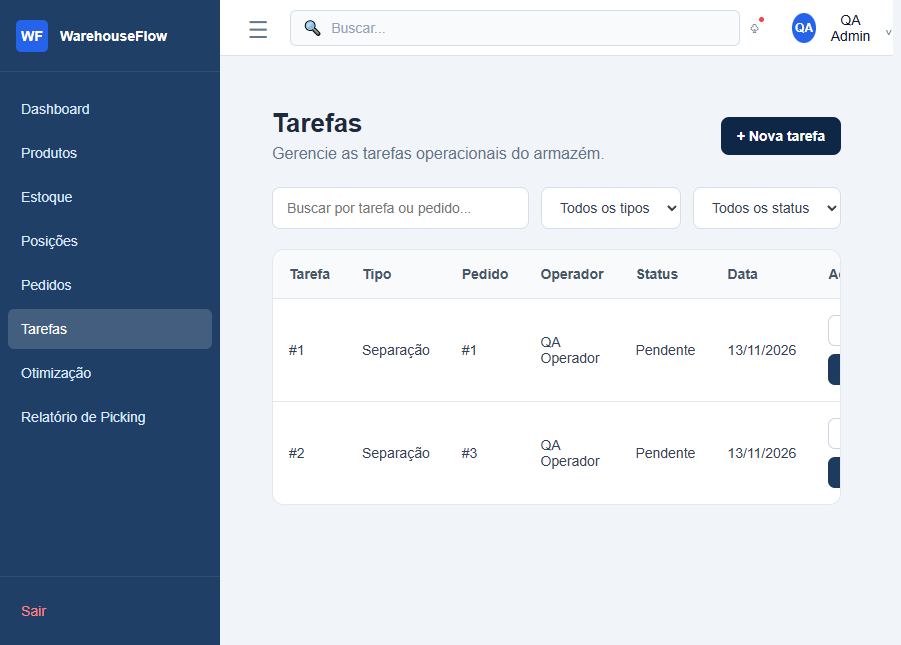
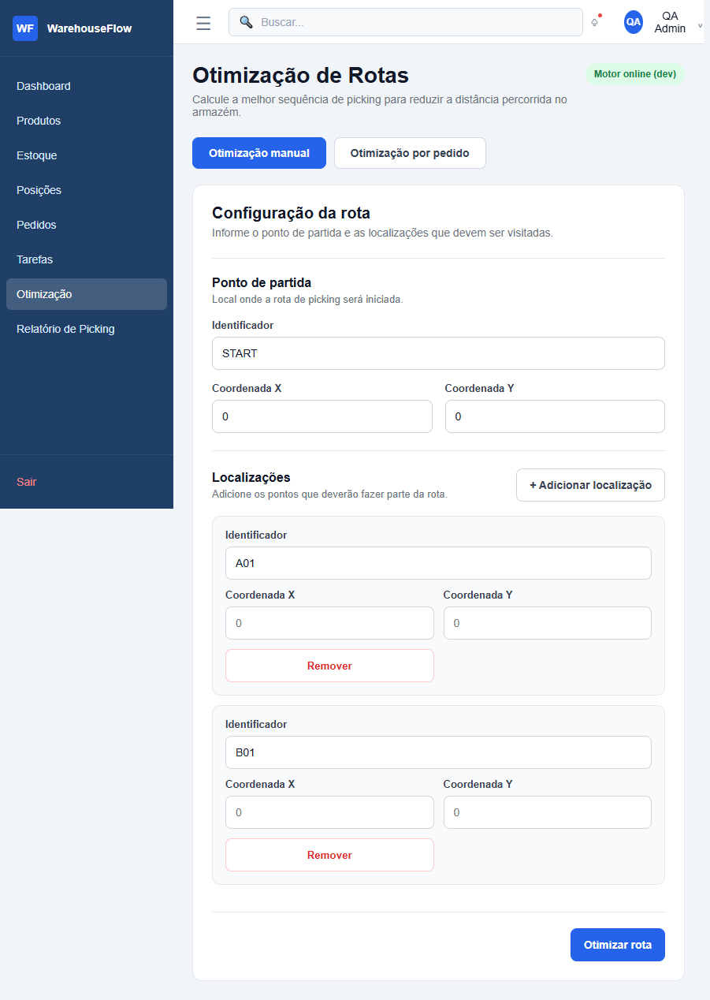
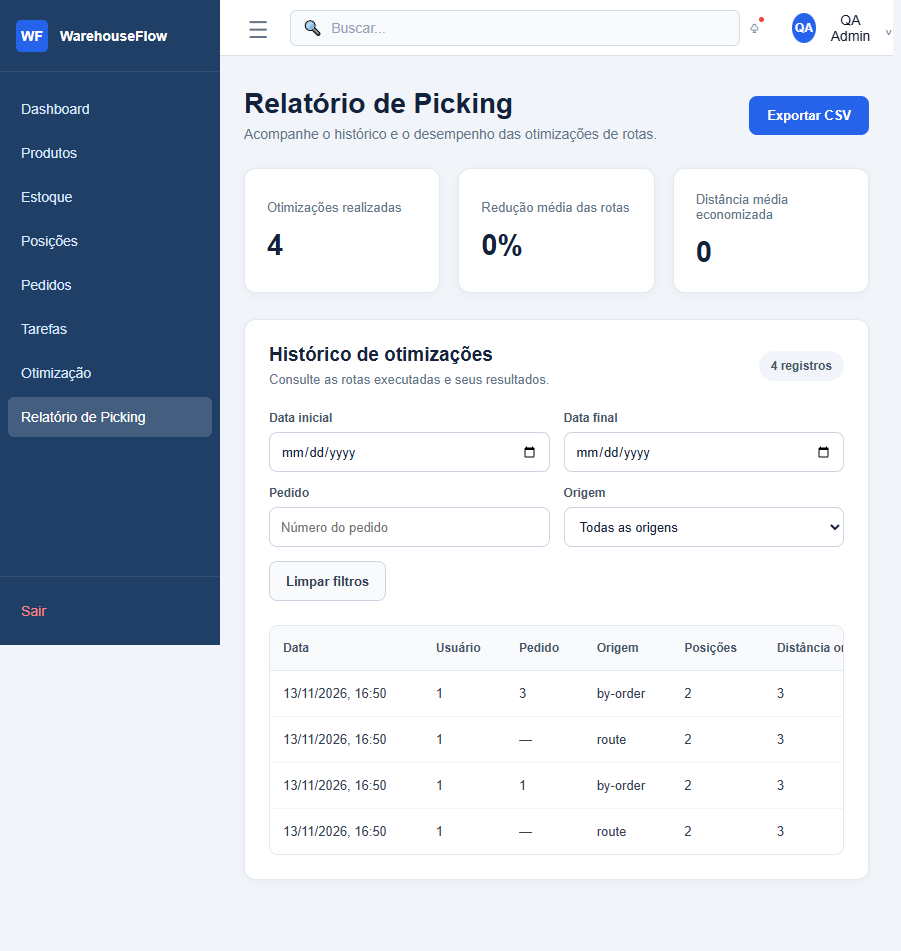
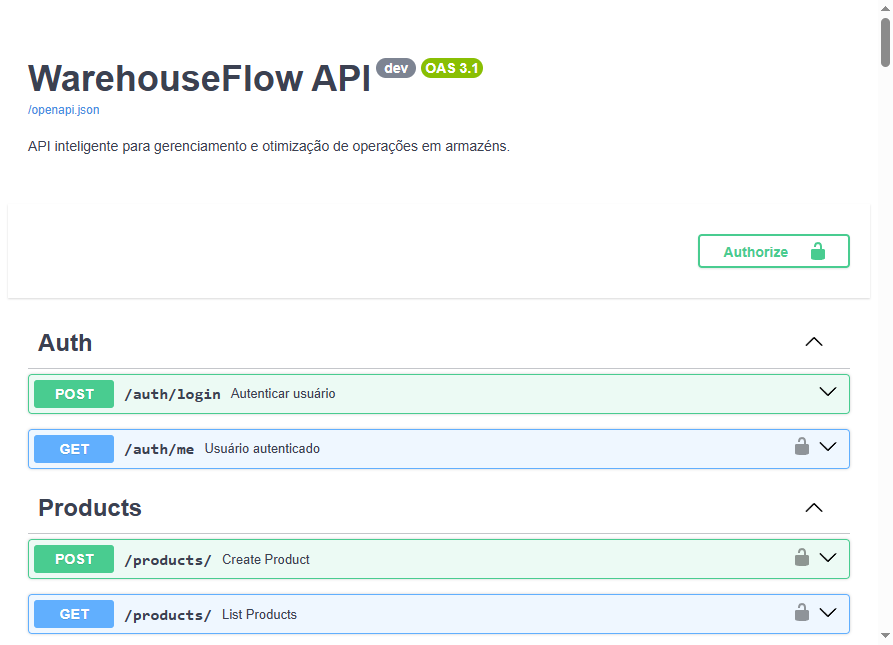

# Sprint 10 — WarehouseFlow | Relatório da Release Candidate

**Grupo:** 26 · **Turma:** 8MB · **Data da validação:** 13/11/2026  
**Repositório:** [thiagodemorais87/WarehouseFlow](https://github.com/thiagodemorais87/WarehouseFlow)  
**Escopo:** documentação, testes e preparação da RC; execução da aplicação e
verificação dos contratos existentes. Este relatório distingue validações
realizadas de itens bloqueados.

**PDF acumulado:** [Grupo26_WarehouseFlow_Sprint10_RC.pdf](../Grupo26_WarehouseFlow_Sprint10_RC.pdf) —
capa RC atualizada, 101 páginas do acumulado Sprints 1–9 preservadas e
relatório/evidências da Sprint 10. O apêndice usa fonte Unicode para exibir
corretamente os caracteres da documentação em português.

> **Estado da RC:** a API e a interface Jinja foram iniciadas e os testes
> executados em uma base SQLite descartável. O Compose foi validado, mas não
> iniciou porque o daemon Docker não estava disponível. Portanto, esta entrega
> não certifica PostgreSQL, Nginx ou persistência em containers.

## A. Descrição da RC

### O que entra nesta versão

- Autenticação JWT, cookie de sessão e autorização por `ADMIN`, `GESTOR` e
  `OPERADOR`.
- API e telas Jinja para produtos, estoque, posições, pedidos e tarefas.
- Dashboard; relatórios de pedidos, movimentações de estoque e picking; CSV
  nos relatórios implementados.
- Otimização de picking com Nearest Neighbor + 2-opt, distância Manhattan,
  rota por posições ou por pedido OUTBOUND, métricas e histórico.
- Endpoints de usuários/cargos e regras de acesso. **A administração de
  usuários não tem tela no menu atual.**
- Contrato de API atualizado em [Api-doc.md](../Api-doc.md), README e este
  conjunto de evidências.

### Alterações do repositório após o relatório da Sprint 09

O histórico entre `de38073` (documentação de execução da Sprint 09) e o estado
analisado inclui commits de 07–10/11/2026 com validação de e-mail e permissões,
testes funcionais de CRUD, limites e checks no schema, tratamento de conflitos
de integridade, proteção/idempotência do seed, healthcheck do PostgreSQL no
Compose e ajustes nas telas de autenticação, estoque, posições, pedidos e
relatórios. O log não classifica individualmente esses commits como Sprint 10;
eles são registrados aqui como evolução posterior à documentação da Sprint 09,
sem reclassificar a autoria ou o escopo dos commits.

Na validação desta entrega foi corrigida a importação ausente de `EmailStr`,
que impedia a coleta dos testes e a importação da aplicação. Também foi
alinhado o OpenAPI ao handler de validação da aplicação (`400`, não `422`).

**Referência de repositório observada:** branch `main`, tag Git `2.0.0`.
`APP_VERSION` respondeu `dev` na execução isolada; isso não cria nem certifica
uma release publicada.

## B. Evidências de estabilidade

| Componente / verificação | Resultado observado |
|---|---|
| `docker compose config --quiet` | Passou (código 0). |
| `docker compose up --build -d` | Não iniciado: falha ao conectar ao pipe do Docker Desktop Linux Engine. |
| Containers, PostgreSQL, migrações e seed do Compose | Não executados; não há status de container nem log de container para relatar. |
| API local | Uvicorn iniciado em `127.0.0.1:8000`, com `FRONTEND_DIR` do repositório. |
| Banco da execução | SQLite descartável em `%TEMP%`, não persistente; não representa validação PostgreSQL. |
| Health check | `GET /health` → HTTP `200`, `{"status":"ok","version":"dev"}`. |
| Pytest | `101 passed`, `2 skipped`, `0 failed`, `1` aviso de depreciação; detalhes abaixo. |
| Smoke tests da API | `31 passed`, `0 failed`, incluindo login, fluxo de pedido, picking, relatórios, RBAC, otimização, validação e logout. |
| Navegação no navegador | Login/logout e `/dashboard`, `/pedidos`, `/tarefas`, `/otimizacao`, `/relatorios/picking` responderam/carregaram com HTTP `200`. |
| Swagger/OpenAPI | `/docs` e `/openapi.json` responderam HTTP `200`; 39 caminhos OpenAPI, com validação documentada como `400`. |

O serviço frontend em Compose (`nginx:alpine`, porta `8080`) não foi iniciado.
As telas capturadas foram servidas pelo backend local em `:8000`; portanto não
comprovam o proxy Nginx.

### Pytest

Resultado final salvo em
[S10-pytest-results.txt](./evidencias/S10-pytest-results.txt):

- **101 aprovados**
- **2 ignorados**, sem falha:
  - teste de tela de usuários: o link/página ainda não existe;
  - geração opt-in da matriz: exige `GERAR_MATRIZ=1` e atualiza
    `docs/matriz-permissoes.md`; não foi executada para preservar o documento.
- **1 aviso:** depreciação do uso de `httpx` com `starlette.testclient`.

### Smoke tests e health check

Os 31 resultados individuais estão em
[S10-smoke-results.json](./evidencias/S10-smoke-results.json). O fluxo
verificou, entre outros:

1. `/health` e Swagger;
2. login JWT e `/auth/me`;
3. dashboard;
4. criação/listagem de pedido OUTBOUND e tarefa PICKING;
5. relatórios JSON e CSV;
6. listagem de usuários/cargos e restrição de escrita por OPERADOR;
7. otimização explícita e por pedido e histórico;
8. entradas inválidas (`400`), ausência de token (`401`) e logout (`303`).

As telas de usuário não foram marcadas como aprovadas: o backend expõe a API,
mas não existe página de administração no menu. O smoke de tarefas confirmou
as rotas e permissões pela API; não substitui uma validação de fluxo manual em
PostgreSQL.

Evidências pontuais:

- [Health check HTTP](./evidencias/S10-health-check.txt)
- [Log da API local](./evidencias/S10-api-log.txt)
- [Validação do Compose e bloqueio do daemon](./evidencias/S10-docker-compose.txt)
- [OpenAPI gerado](./evidencias/S10-openapi.json)
- [Caminhos OpenAPI](./evidencias/S10-openapi-paths.txt)
- [Respostas de validação documentadas no OpenAPI](./evidencias/S10-openapi-validation.txt)

## C. Interface final

As capturas abaixo são screenshots reais do navegador integrado, obtidas da
aplicação local com registros QA temporários na base descartável. Não
representam dados de produção nem containers Compose.

### Login e dashboard

### Navegação e fluxos

### Swagger

## D. Banco de dados

### Estrutura e MER

O DDL `backend/database/schema.sql` contém as tabelas `roles`, `users`,
`products`, `warehouses`, `locations`, `stock`, `orders`, `order_items`,
`tasks` e `optimization_results`. O modelo ORM
`backend/app/models/optimization_run.py` acrescenta `optimization_runs`,
criada por `Base.metadata.create_all` quando esse modelo está carregado.

A base SQLite temporária de smoke test apresentou **11 tabelas**. Sua
introspecção real, sem dados de linha ou credenciais, está em
[S10-database-schema.txt](./evidencias/S10-database-schema.txt). Ela não prova
que o mesmo schema foi aplicado ao PostgreSQL.

Relacionamentos principais: role→users; warehouse→locations;
product/location→stock; order→order_items/tasks; product→order_items;
user→tasks atribuídas; task→optimization_results; location→resultado de
otimização sugerido. `stock` restringe duplicidade do par produto/posição;
quantidade de estoque é não negativa; itens de pedido exigem quantidade
positiva. `optimization_runs.user_id` e `order_id` são valores de histórico
sem FK declarada no modelo.

MER atualizado: [mer-final.md](./mer-final.md). A confirmação de migrações,
seed e estrutura em PostgreSQL depende de executar o Compose em ambiente com
daemon disponível.

## E. APIs

- **Swagger UI:** [http://127.0.0.1:8000/docs](http://127.0.0.1:8000/docs)
- **OpenAPI:** [http://127.0.0.1:8000/openapi.json](http://127.0.0.1:8000/openapi.json)
- **Referência textual:** [docs/Api-doc.md](../Api-doc.md)
- **Evidência gerada:** [lista de caminhos e contratos](./evidencias/S10-openapi-paths.txt)

Foram documentados autenticação (`/auth/*`), pedidos, tarefas, usuários/cargos,
relatórios e `/optimization/*`, incluindo métodos, roles, entradas, exemplos,
respostas e erros verificados no código. A correção do OpenAPI substitui o
`422` automático pelo `400` real do handler de validação e documenta o formato
`detail` + `errors`; há teste de regressão em `tests/test_openapi.py`.

O snapshot da execução contém 39 paths no schema gerado; o Swagger exibiu 65
operações. Outras rotas (`/products`, `/stock`, `/locations`,
`/optimization-results`) continuam disponíveis no Swagger e são apontadas
como fora do recorte textual pedido.

## F. Repositório, README e execução

- **GitHub:** [thiagodemorais87/WarehouseFlow](https://github.com/thiagodemorais87/WarehouseFlow)
- **README:** [README.md](../../README.md), atualizado com funcionalidades,
  arquitetura, tecnologias, requisitos, configuração segura de `.env`,
  Compose, testes, URLs, Swagger, documentação de API e Sprint 10.
- **Tecnologias observadas:** Python, FastAPI, SQLAlchemy, Pydantic,
  PostgreSQL, HTML/CSS/Jinja2/JavaScript, Nginx, Docker Compose e Pytest.
- **URLs Docker documentadas:** UI `:8080`, API/Swagger `:8000`, PostgreSQL
  host `:5433`.

Os comandos de instalação e inicialização estão no README. `.env` não foi
aberto nem sobrescrito nesta execução. O acesso efetivamente verificado foi
`http://127.0.0.1:8000`; `:8080` e `:5433` ficaram sem validação porque o
daemon Docker não iniciou.

## G. Correções da Sprint 10 e regressão

### BUG-S10-01 — import ausente de `EmailStr`

- **Sintoma:** antes da alteração, `pytest` interrompeu a coleta de sete
  módulos com `NameError: name 'EmailStr' is not defined` ao importar
  `backend/app/schemas/__init__.py`.
- **Correção:** importação de `EmailStr` adicionada ao módulo Pydantic.
- **Regressão:** depois da correção, a suíte concluiu com 101 aprovados e
  nenhum erro de coleta/falha.

### DOC-S10-01 — contrato de validação divergente no Swagger

- **Sintoma:** o handler devolvia HTTP `400`, mas a resposta automática
  OpenAPI anunciava `422`.
- **Correção:** schema OpenAPI substitui a resposta de validação por `400` e
  descreve o JSON `{detail, errors}`; resposta do endpoint e OpenAPI foram
  conferidos e há teste em `tests/test_openapi.py`.

Não houve outra correção de bug de produto confirmada nesta execução. As
correções da Sprint 09 permanecem registradas no relatório e evidências
anteriores; não foram reescritas.

## H. Pendências, riscos e próximos passos

1. Iniciar Docker Desktop e executar `docker compose up --build`; verificar
   estado/logs de API, frontend/Nginx e PostgreSQL, `/health` através da API,
   seed, migrações e persistência após reinicialização.
2. Confirmar se `optimization_runs` é criado/aplicado corretamente em uma
   instância PostgreSQL limpa e já existente.
3. Implementar/validar manualmente a interface de administração de usuários,
   caso continue no escopo. A API já existe; a tela não.
4. Executar a geração opt-in de matriz (`GERAR_MATRIZ=1`) em ambiente
   controlado, se a equipe optar por atualizar `docs/matriz-permissoes.md`.
5. **Sprint 11 (21/11):** manual do usuário, manual técnico, revisão completa
   de código e organização final do GitHub.
6. **Sprint 12 (28/11):** correções finais, code freeze/tag/release, vídeos e
   ensaio da apresentação; entrega final permanece em 05/12 conforme o
   cronograma.

**Risco conhecido:** a RC ainda não tem evidência de operação integrada em
PostgreSQL + Nginx/Compose neste ambiente. Os testes SQLite não substituem
essa validação.

## I. Integrantes

| Integrante | Matrícula | Papel registrado |
|---|---:|---|
| Gabriel George de Araújo Figueiredo | 01605236 | O papel individual não está nominalmente identificado nas fontes consultadas. |
| Guilherme Branco Ferrario | 01596391 | Documentação e Testes nesta entrega, conforme designação da Sprint 10; documentos anteriores nomeiam a função como “Pessoa 5”, sem associar essa numeração a um integrante. |
| João Pedro Silva de Araujo | 01606470 | O papel individual não está nominalmente identificado nas fontes consultadas. |
| Sérgio José de Araújo Júnior | 01590694 | O papel individual não está nominalmente identificado nas fontes consultadas. |
| Thiago de Morais Gonçalves | 01609695 | O papel individual não está nominalmente identificado nas fontes consultadas. |

Os cinco nomes, matrículas, Grupo 26 e turma 8MB foram conferidos no README e
no PDF acumulado anterior. As responsabilidades antigas são descritas por
número de pessoa, não por nome; os papéis não mapeados permanecem explicitamente
sem atribuição para evitar inventar informações.
